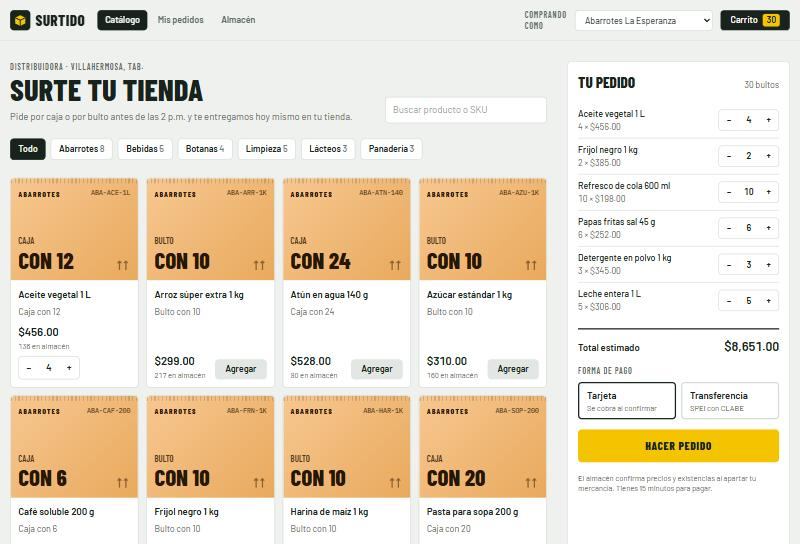
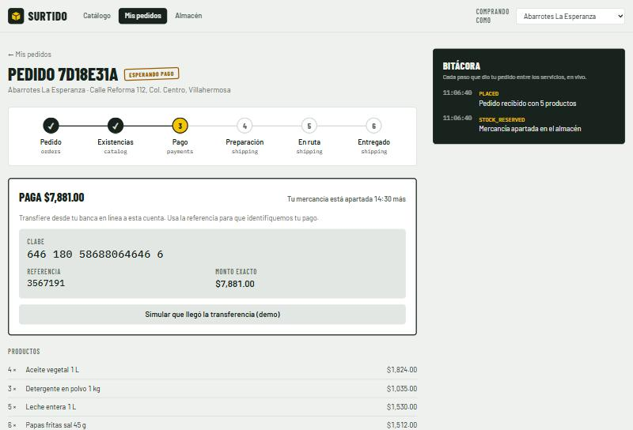
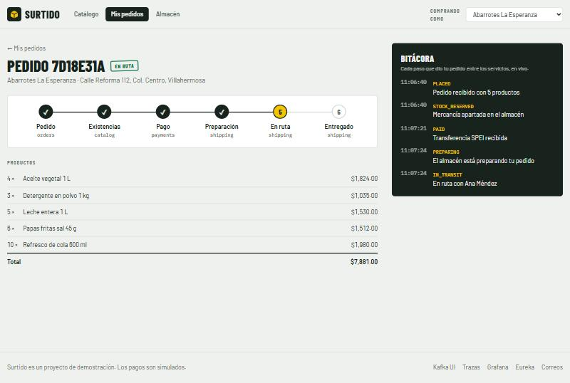
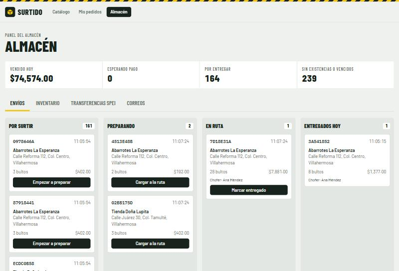
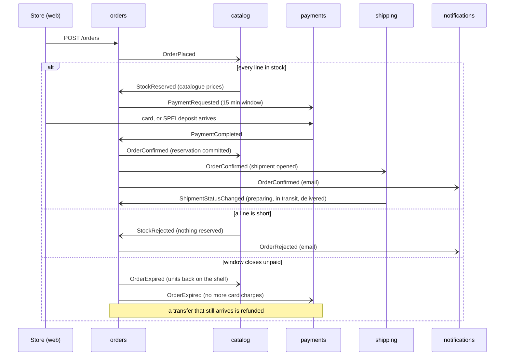
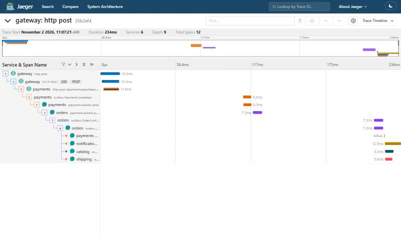

<h1 align="center">Surtido</h1>

<p align="center">
  <strong>Wholesale ordering for corner stores, fulfilled by a saga over Kafka.</strong><br />
  A distributor's catalogue, all-or-nothing stock reservations, card and SPEI payments with a deadline, deliveries the warehouse moves along, and emails that retry on their own.
</p>

<p align="center">
  <a href="https://github.com/AngelArteachi/surtido/actions/workflows/ci.yml"></a>
  
  
  
  
</p>

<p align="center">
  
  
  
  
</p>

---

## The business

In Mexico most groceries reach people through *tienditas*, small corner stores
that restock several times a week from a distributor. Surtido is that
distributor's ordering system. A store orders boxes and sacks from the
catalogue and pays by card or by **SPEI** bank transfer; the warehouse prepares
the order, sends it out with a driver and marks it delivered; the store gets
an email at each step.

The interface is in Spanish, for the stores. Code and documentation are in English.

## The saga

An order touches four services and none of them can share a transaction, so
the orders service orchestrates a saga and every other service answers it
through Kafka:



What makes it hold up:

| Problem | How Surtido handles it |
| --- | --- |
| Two stores buy the last units | Each line is a conditional `UPDATE … WHERE stock >= :quantity`; all lines of an order commit together or not at all. |
| A service crashes between saving and publishing | Transactional outbox: the event is a row in the same transaction, relayed to Kafka afterwards. |
| Kafka delivers a message twice | Every consumer records the event id in the same transaction as its work; the second delivery does nothing. |
| Replies arrive out of order | A status machine with row locks: an order never moves backwards or skips payment. |
| The store never pays | The window closes on its own, the stock goes back on sale, and late money is refunded. |
| The mail server is down | Emails move through Kafka retry topics (2 s, 4 s, 8 s) and then a dead-letter topic, without blocking newer emails. |

Why each piece is built this way, and what it costs, is in
[docs/decisions.md](docs/decisions.md).

## Load test: a flash sale

`loadtest/flash-sale.js` restocks a scarce product, then sends 400 stores at
once, each ordering one unit of it plus two of a plentiful product, and pays
every order it can by card. Results on a laptop running the whole stack in
Docker Desktop:

| | |
| --- | --- |
| Scarce units available | 162 |
| Units sold | **162**, none oversold, stock never below zero |
| Orders confirmed / rejected | 162 / 238 |
| Server errors | **0** of 5,651 requests |
| Place an order, p95 | 759 ms |
| Pay by card, p95 | 103 ms |
| Order placed to confirmed, p95 | 8.6 s, under a burst of 400 orders in two seconds, including the test's own 0.5 s polling |

The rejected orders took nothing: the integration tests check that a rejected
order gives back every unit it had reserved on its other lines. CI runs the
same scenario with 200 stores on every push.

## One trace across the saga

The outbox stores each event's trace context, so the relay continues the
request's trace when it publishes. This is a single trace for a SPEI deposit:
the gateway, payments, Kafka, orders confirming, and the four services that
react to the confirmation.

<p align="center"></p>


## Services

| Module | Responsibility |
| --- | --- |
| `platform/discovery` | Eureka service registry |
| `platform/gateway` | Spring Cloud Gateway: one public entry point, routes to services through the registry |
| `services/catalog` | Products, stock, reservations; restocking for the warehouse |
| `services/orders` | Stores, orders, the saga, the payment window, the order timeline |
| `services/payments` | Card payments with a simulated network; SPEI with a per-order CLABE (valid check digit) and reference |
| `services/shipping` | Shipments the warehouse moves from pending to delivered, with driver assignment |
| `services/notifications` | HTML emails to the stores, retried through retry topics |
| `libs/contracts` | Event records shared by every service |
| `libs/messaging` | Outbox, relay, idempotent inbox, Kafka error handling, shared Flyway migration |
| `web` | React app: catalogue and cart, live order tracker, warehouse panel |

## Run it

Requires Docker. The first build downloads Maven dependencies and takes a few minutes.

```bash
docker compose up -d --build --wait
```

| | |
| --- | --- |
| App | <http://localhost:8090> |
| Gateway | <http://localhost:8091/api/products> |
| Eureka | <http://localhost:8761> |
| Kafka UI | <http://localhost:8092> |
| Traces (Jaeger) | <http://localhost:16687> |
| Grafana | <http://localhost:3001> |
| Emails (Mailpit) | <http://localhost:8026> |

Pay with the test card `4242 4242 4242 4242`; `4000 0000 0000 0002` is
declined. For SPEI, the order page and the warehouse panel can simulate the
deposit.

```bash
node scripts/smoke.mjs
```

```bash
docker compose --profile loadtest run --rm k6
```

If image builds fail with certificate errors because an antivirus or proxy
inspects HTTPS, see `docker-compose.override.example.yml`.

### Develop

```bash
./mvnw verify
```

`verify` runs the unit tests and the `*IT` integration tests, which start
PostgreSQL in Docker with Testcontainers. For the web app, `npm install` and
`npm run dev` in `web/` serve it with hot reload against the gateway on
`localhost:8091`.

## Observability

Every service exports Prometheus metrics and OpenTelemetry traces (see the
trace above). Grafana ships with a
dashboard for orders by outcome, time to confirm, reservations, card results,
email retries, outbox throughput and consumer lag.

## Where this came from

Surtido rebuilds six repositories from a university microservices course
(`apigateway`, `eureka-server`, `productos-service`, `ordenes-service`,
`pagos-service`, `broker-message-be`) into one project with a real use case.
The gateway, the registry, Kafka events, payments, shipments and email
retries all come from there; the decisions document lists what changed and why.

## Stack

Java 21, Spring Boot 4 (Web MVC, JDBC, Flyway, Kafka, Mail, Actuator), Spring
Cloud 2025.1 (Gateway, Netflix Eureka), Apache Kafka 4 in KRaft mode,
PostgreSQL 17, Micrometer with Prometheus and OpenTelemetry, Testcontainers,
React 19 with React Router, TanStack Query and Tailwind CSS 4, k6, Docker
Compose and GitHub Actions.

## License

MIT
